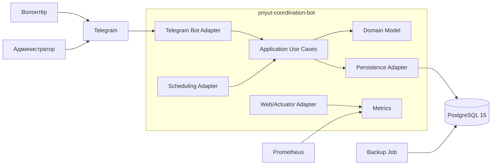
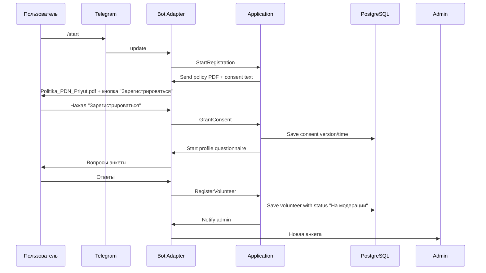
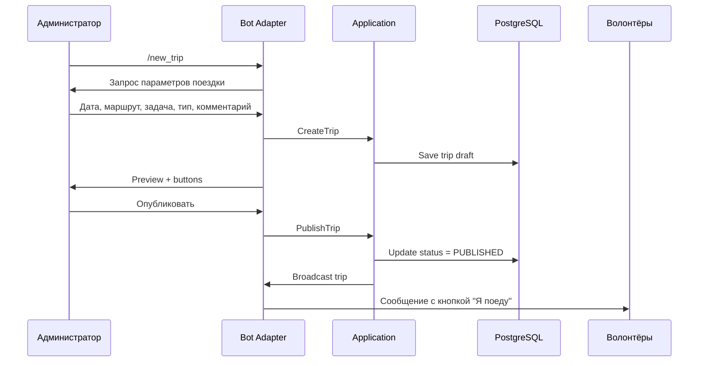
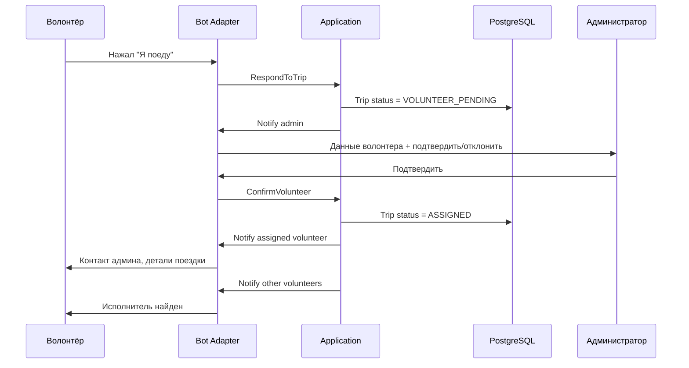
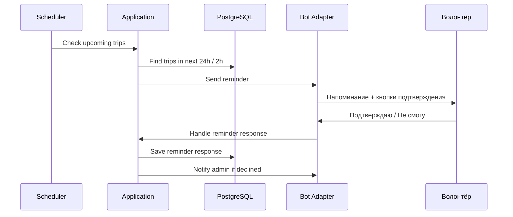
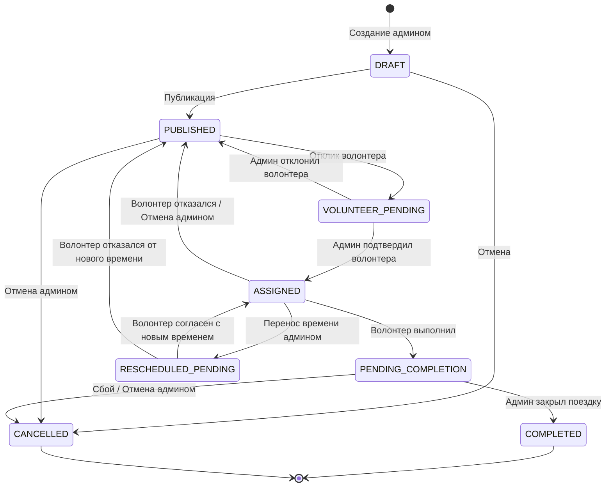
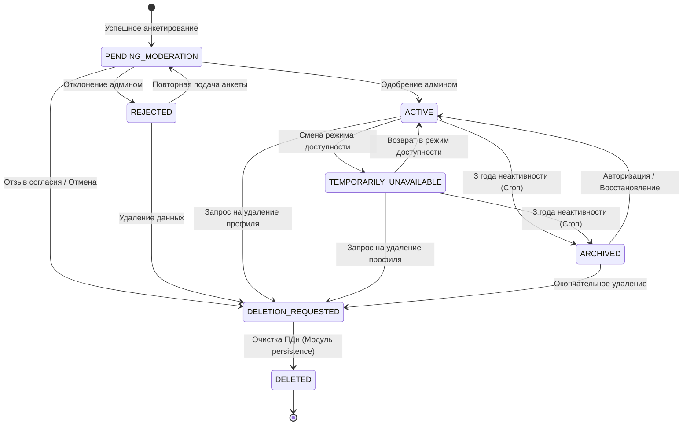
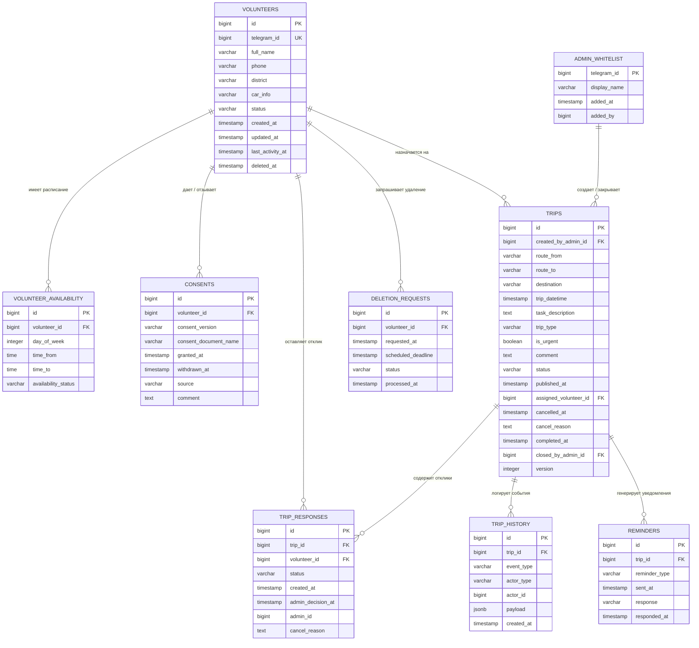

# Архитектура системы координации автоволонтеров «Приют»

**Проект:** `priyut-coordination-bot`  
**Версия документа:** 1.0  
**Статус:** Draft / Working baseline  
**Дата:** 17.10.2026

---

## 1. Назначение документа

Документ описывает архитектуру системы координации автоволонтеров для приюта «Приютино».

Система решает следующие задачи:

- сбор базы автоволононтеров через Telegram-бот;
- модерация волонтеров администратором;
- создание поездок администратором;
- отклик волонтеров на поездки;
- подтверждение или отклонение кандидатуры администратором;
- отмена и перенос поездок;
- напоминания за 24 часа и за 2 часа до поездки;
- двухэтапное завершение поездки;
- хранение истории поездок;
- экспорт истории в CSV;
- соблюдение требований 152-ФЗ: согласие, отзыв согласия, удаление персональных данных;
- мониторинг и метрики для эксплуатации.

Целевой показатель: сокращение времени организации поездки до 5 минут.

---

## 2. Границы проекта

### 2.1. Что входит в систему

- Telegram-бот для волонтеров и администраторов.
- Бэкенд на Java / Spring Boot.
- База данных PostgreSQL 15.
- Миграции базы данных через Flyway.
- Docker и Docker Compose для развертывания.
- Автоматические напоминания о поездках.
- Журналирование согласий и отзывов согласий на обработку ПДн.
- Метрики через Spring Boot Actuator и Prometheus.
- Резервное копирование базы данных.

### 2.2. Что не входит в систему

Согласно ТЗ, в первой версии нет:

- веб-админки;
- мобильного приложения;
- интеграции с картами;
- автоматического подбора волонтера;
- системы рейтингов и черных списков;
- приема платежей и донатов.

---

## 3. Общий контекст системы

## 4. Целевой технологический стек

| Компонент | Технология | Комментарий |
| :--- | :--- | :--- |
| **Язык** | Java 25 | ТЗ допускает Java 21+, проект использует более новую LTS-версию |
| **Фреймворк** | Spring Boot 4.x | При необходимости строгой совместимости возможен откат на Spring Boot 3.x |
| **Сборка** | Gradle Kotlin DSL | Используется version catalog и build-logic |
| **Доступ к БД** | Spring JDBC | Осознанный отказ от JPA/Hibernate ради прозрачного SQL и меньшего потребления памяти |
| **База данных** | PostgreSQL 15 | Хранение анкет, поездок, истории, согласий |
| **Миграции** | Flyway | Версионированные SQL-миграции |
| **Интерфейс** | Telegram Bot API | Только Telegram, без веб-сайта |
| **Контейнеризация** | Docker + Docker Compose | Развертывание на VPS |
| **Хостинг** | VPS FirstByte, Москва | Требования 152-ФЗ: сервер в РФ |
| **Метрики** | Micrometer + Prometheus + Spring Actuator | Наблюдаемость и эксплуатация |
| **Тесты** | JUnit 5, AssertJ, Mockito, Testcontainers | Юнит и интеграционные тесты |

## 5. Архитектурный стиль

Принят архитектурный стиль: **модульный монолит** с элементами **гексагональной архитектуры** (*ports and adapters*).

#### Причины выбора:
* **Небольшой размер команды** — минимизирует накладные расходы на коммуникацию и синхронизацию.
* **Умеренная нагрузка** — до 500 волонтеров и до 50 поездок в день не требуют сложного масштабирования.
* **Отсутствие избыточных требований** — в ТЗ нет жестких условий по использованию микросервисов.
* **Простота эксплуатации** — система легко разворачивается и администрируется на одном VPS.
* **Гибкость на будущее** — архитектура оставляет возможность при необходимости вынести отдельные модули в самостоятельные сервисы позже.

## 6. Модульная структура проекта

Проект организован по принципу модульного монолита. Ниже представлено назначение каждого модуля:

* **`app`** — точка входа приложения, конфигурация, композиция модулей, сборка executable jar.
* **`domain`** — ядро системы: бизнес-сущности, правила, статусы и доменные события.
* **`application`** — сценарии использования (use cases), входные и выходные порты приложения.
* **`infrastructure`** — внешние адаптеры и технические детали реализации:
    * **`/persistence`** — доступ к PostgreSQL через Spring JDBC, управление схемами и Flyway-миграции.
    * **`/telegram`** — интеграция с Telegram Bot API, обработка команд, кнопок и логика диалогов.
    * **`/scheduling`** — фоновые процессы, отправка напоминаний, архивация и регулярные задачи.
* **`tests`** — изолированное окружение для тестирования:
    * **`/test-fixtures`** — общие тестовые фикстуры, хелперы и билдеры объектов.
    * **`/integration-tests`** — сквозные интеграционные тесты с использованием Testcontainers.

## 7. Основные бизнес-объекты

### 7.1. Волонтёр
Хранит анкету волонтера:
* **Внутренний идентификатор**
* **Telegram ID**
* **Имя**
* **Телефон**
* **Район**
* **Автомобиль**
* **Статус анкеты**
* **Режим доступности**
* **Дата последней активности**
* **Признаки удаления/архивации**

### 7.2. Согласие на обработку ПДн
Хранит сведения о согласии:
* **Идентификатор волонтера**
* **Версия политики**
* **Дата и время согласия**
* **Дата и время отзыва согласия**
* **Источник действия**
* **Комментарий или техническая отметка**

### 7.3. Режим доступности
Хранит доступность волонтера:
* **Дни недели**
* **Временные интервалы**
* **Статус** (доступен / временно недоступен)

### 7.4. Поездка
Хранит заявку на поездку:
* **Идентификатор**
* **Маршрут**
* **Пункт назначения**
* **Дата и время**
* **Задача**
* **Тип** (обычная / срочная)
* **Комментарий**
* **Статус**
* **Назначенный волонтер**
* **Автор-администратор**
* **Версия записи** (для оптимистичной блокировки)

### 7.5. Отклик / назначение волонтера
Хранит взаимодействие волонтера с поездкой:
* **Поездка**
* **Волонтер**
* **Статус отклика**
* **Время отклика**
* **Решение администратора**
* **Причина отмены**

### 7.6. История поездки
Хранит события жизненного цикла поездки:
* **Создание**
* **Публикация**
* **Отклик**
* **Подтверждение**
* **Отклонение**
* **Отмена**
* **Перенос времени**
* **Напоминание**
* **Отметка о выполнении**
* **Закрытие поездки**

## 8. Роли и права доступа

| Роль | Права | Способ доступа |
| :--- | :--- | :--- |
| **Волонтёр** | Просмотр поездок, отклик, профиль, доступность, отмена своей поездки, завершение поездки, удаление профиля, отзыв согласия | `/start`, команды и инлайн-кнопки бота |
| **Администратор** | Создание поездок, подтверждение волонтеров, отмена и перенос поездок, просмотр анкет, модерация, закрытие поездок, экспорт истории | Внесение Telegram ID в белый список (через конфигурацию/БД) |
| **Разработчик / оператор эксплуатации** | Развертывание, настройка токена, белый список админов, бэкапы, сбор и просмотр метрик | SSH-доступ к серверу и доступ к Git-репозиторию |

## 9. Ключевые сценарии и потоки данных

### 9.1. Регистрация волонтера

Важно: регистрация считается начатой только после явного нажатия кнопки «Зарегистрироваться».

### 9.2. Создание и публикация поездки

### 9.3. Отклик и подтверждение волонтера

### 9.4. Напоминания

## 10. Статусная модель поездки

### Таблица статусов и описаний

| Статус | Описание |
| :--- | :--- |
| **DRAFT** | Поездка создана администратором, но еще не опубликована |
| **PUBLISHED** | Поездка опубликована и доступна для откликов волонтеров |
| **VOLUNTEER_PENDING** | Есть отклик волонтера, ожидается подтверждение администратора |
| **ASSIGNED** | Администратор подтвердил волонтера, поездка закреплена за ним |
| **PENDING_COMPLETION** | Волонтёр отметил поездку выполненной, ожидается закрытие администратором |
| **COMPLETED** | Администратор закрыл поездку, данные сохранены в историю |
| **CANCELLED** | Поездка отменена администратором или волонтером по сценарию |
| **RESCHEDULED_PENDING** | Время поездки изменено, требуется повторное подтверждение волонтера |

#### Жизненный цикл поездки (State Diagram)

#### Дополнительные признаки (Флаги напоминаний)
Для автоматизации процесса контроля поездок в модуле `infrastructure/scheduling` используются технические маркеры уведомлений:
* **`REMINDER_24_SENT`** — отправлено напоминание за 24 часа до выезда.
* **`REMINDER_2_SENT`** — отправлено финальное напоминание за 2 часа до выезда.
* **`REMINDER_CONFIRMED`** — волонтер подтвердил актуальность поездки через инлайн-кнопку в напоминании.
* **`REMINDER_DECLINED`** — волонтер нажал кнопку отмены в напоминании (триггер для возврата в `PUBLISHED` или `CANCELLED`).

## 11. Статусная модель волонтера

### Таблица статусов и описаний

| Статус | Описание |
| :--- | :--- |
| **PENDING_MODERATION** | Анкета заполнена и ожидает проверки администратора |
| **ACTIVE** | Волонтёр одобрен администратором и может откликаться на поездки |
| **REJECTED** | Анкета отклонена администратором (не пройдена модерация) |
| **TEMPORARILY_UNAVAILABLE** | Волонтёр временно отключил доступность (отпуск, личные обстоятельства) |
| **DELETION_REQUESTED** | Пользователь запросил удаление профиля и отзыв согласия на обработку ПДн |
| **DELETED** | Персональные данные полностью очищены/обезличены в соответствии с 152-ФЗ |
| **ARCHIVED** | Профиль архивирован автоматически по истечении 3 лет полной неактивности |

#### Жизненный цикл волонтера (State Diagram)

## 12. Модель данных верхнего уровня

Ниже приведена логическая модель. Физические таблицы описываются в Flyway-миграциях.

### Схема связей данных (ER-диаграмма)

#### Краткое описание ключевых связей:
* **Обезличивание и 152-ФЗ:** Таблицы `consents` и `deletion_requests` жестко привязаны к `volunteers`. При переходе волонтера в статус `DELETED` персональные данные стираются из `volunteers`, но история в `trips` сохраняется (благодаря связи с сохранением ссылочной целостности или через каскадные правила, если это необходимо).
* **Аналитика и аудит:** Таблица `trip_history` содержит поле `payload` типа `jsonb` для гибкого логирования изменений полей поездки (например, старое/новое время при переносе).
* **Безопасность:** Таблица `admin_whitelist` выступает изолированным реестром Telegram ID, имеющих доступ к административным методам в модуле `infrastructure/telegram`.

## 13. Доступ к базе данных

В проекте используется **Spring JDBC** вместо JPA/Hibernate. Это осознанный выбор инженерного стека.

### Причины выбора:
* **Предсказуемый SQL** — полное исключение скрытых запросов (N+1, неявные Lazy Initialization-исключения).
* **Экономия памяти** — отсутствие тяжелого контекста постоянства (Persistence Context), кэшей первого/второго уровня и прокси-объектов.
* **Полный контроль** — легкая оптимизация сложных выборок для аналитики или истории.
* **Соответствие нагрузке** — возможностей Spring JDBC с запасом хватает для объема данных проекта.
* **Соответствие 152-ФЗ** — прямое управление SQL упрощает выполнение точечных процедур маскирования, архивации и физического удаления (`hard delete`) персональных данных волонтеров.

#### Инструментарий разработки:
* `JdbcTemplate` и `NamedParameterJdbcTemplate` — для выполнения всех SQL-запросов.
* `SimpleJdbcInsert` — для удобной вставки новых записей без написания громоздких выражений `INSERT INTO`.
* `RowMapper` — для явного и безопасного маппинга строк из ResultSet в иммутабельные доменные объекты (Java Records).
* **Управление транзакциями** — декларативное через аннотацию `@Transactional` строго на уровне `application`-слоя (Use Cases / Интеракторы).

---

## 14. Время и часовые пояса

Правила работы с временными метками для обеспечения консистентности данных:
* **Хранение в БД** — абсолютно все даты и время записываются в типе данных `TIMESTAMP WITH TIME ZONE` (или переводятся) строго в часовом поясе **UTC**.
* **Интерфейс пользователя** — ввод данных администратором и отображение дат волонтерам в Telegram происходит исключительно в локальном времени **Europe/Moscow** (MSK, UTC+3).
* **Логика уведомлений** — расчет интервалов отправки напоминаний (24 часа и 2 часа до поездки) привязан к московскому времени.
* **Тестирование** — в тестовой конфигурации (`tests/*`) через сборочный скрипт Gradle принудительно задается системный параметр `-Duser.timezone=UTC`. Это гарантирует стабильность и воспроизводимость тестов независимо от локальных настроек машин разработчиков или CI/CD серверов.

---

## 15. Интеграция с Telegram

### 15.1. Способ подключения
Для MVP выбран режим **Long Polling** (метод `getUpdates`).

#### Причины выбора:
* **Автономность** — не требует организации публичного доменного имени и настройки доверенного HTTPS-сертификата (SSL/TLS).
* **Простота инфраструктуры** — приложение само тянет данные из Telegram API, что минимизирует конфигурацию сети на VPS FirstByte.
* **Изолированность** — отсутствие необходимости открывать входящие порты в брандмауэре сервера.
* **Производительность** — пропускной способности Long Polling с запасом хватает для заявленной нагрузки (до 500 пользователей).

*В будущем архитектура модульного монолита позволит бесшовно заменить адаптер `infrastructure/telegram` на Webhook.*

### 15.2. Обработка обновлений (Идемпотентность)
Для предотвращения сетевых дублей и повторной обработки одних и тех же сообщений:
* Каждое входящее событие валидируется по `update_id`.
* Инлайн-кнопки (`InlineKeyboardMarkup`) генерируют уникальные идентификаторы в `callback_data`.
* Бизнес-логика проверяет текущий статус сущностей перед изменением (например, повторный клик на кнопку «Откликнуться» в статусе `VOLUNTEER_PENDING` или `ASSIGNED` просто игнорируется или выводит alert-уведомление, не создавая новую запись в `trip_responses`).

### 15.3. Ограничение доступа (RBAC / Права)
Доступ к функционалу жестко разграничен на уровне адаптера `infrastructure/telegram`:
* **Администраторы** — доступ к командам создания, переноса и модерации открывается только после успешной проверки `message.from.id` по внутренней таблице `admin_whitelist`.
* **Волонтеры** — доступ к просмотру активных поездок и откликам открывается только для пользователей, чьи анкеты в таблице `volunteers` находятся в статусе `ACTIVE`.
* **Гости (Неизвестные)** — при любом взаимодействии перенаправляются исключительно на корневую команду `/start` и стартовый сценарий регистрации с принятием политики персональных данных.
